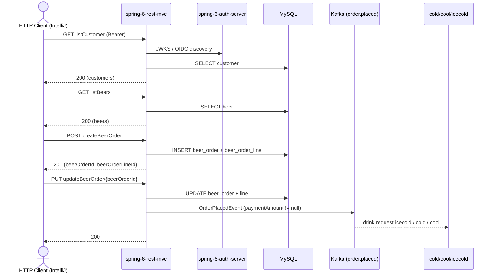

# beerOrder Flow: createBeerOrder → updateBeerOrder

Datei: `restRequest/beerOrder-flow-create-update/beerOrder-flow-create-update.http`

## Ziel

Eine neue Bestellung anlegen und diese anschließend aktualisieren.

## Ablauf (Services)

## Requests (in dieser Reihenfolge)

1. `listCustomer` (1a) – speichert `customerId` (erster Kunde aus der Liste).
   - alternativ `createCustomer` (1b) – speichert `customerId` (neu angelegter Kunde).
2. `listBeers` – speichert `beerId` (erstes Bier aus der Liste).
3. `createBeerOrder` – legt die Order **mit** einer Line an und speichert `beerOrderId` **und** `beerOrderLineId`.
4. `updateBeerOrder` – aktualisiert genau diese Order/Line.

## Benötigte Globals

|       Global        |            gesetzt von            |             genutzt von              |
|---------------------|-----------------------------------|--------------------------------------|
| `customerId`        | `listCustomer` / `createCustomer` | `createBeerOrder`, `updateBeerOrder` |
| `beerId`            | `listBeers`                       | `createBeerOrder`, `updateBeerOrder` |
| `beerOrderId`       | `createBeerOrder`                 | `updateBeerOrder`                    |
| `beerOrderLineId`   | `createBeerOrder`                 | `updateBeerOrder`                    |
| `traceId`, `spanId` | `../scripts/traceparent.js`       | alle Requests (Trace-Korrelation)    |

## Asserts

- `createBeerOrder` → `201`, `id` gesetzt, genau 1 Line.
- `updateBeerOrder` → `200`, `id` entspricht der `{{beerOrderId}}`.

## Hinweise

- Basis-URL ist `{{application-port}}` (Profil `local` = 8081, `k8s` = 30081).
- `updateBeerOrder` mit gesetztem `paymentAmount` publiziert ein `OrderPlacedEvent` → Kafka-Topic `order.placed`
  (danach `drink.request.*` durch den `DrinkSplitterRouter`).
- Ohne vorheriges `listCustomer`/`createCustomer` bzw. `listBeers` sind `customerId`/`beerId` leer → Fehler.
- Die Line im Update muss die zuvor gespeicherte `beerOrderLineId` mitschicken, sonst 404 (die App sucht die Line per `id`).

