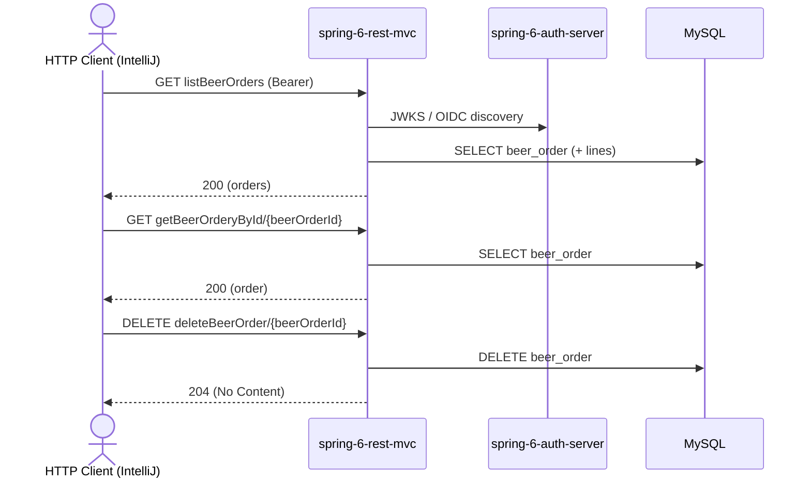

# beerOrder Flow: listBeerOrders → getBeerOrderyById → deleteBeerOrder

Datei: `restRequest/beerOrder-flow-list-get-delete/beerOrder-flow-list-get-delete.http`

## Ziel

Eine bestehende Bestellung aus der Liste holen und anschließend löschen.

## Ablauf (Services)

## Requests (in dieser Reihenfolge)

1. `listBeerOrders` – wählt die **erste Order, die eine Line hat**, und speichert `beerOrderId` **und** `beerOrderLineId`.
2. `getBeerOrderyById` – holt die Order per `beerOrderId`; das Pre-Request-Skript loggt die benutzte `beerOrderId` und wirft einen Fehler, wenn sie nicht gesetzt ist.
3. `deleteBeerOrder` – löscht die Order per `beerOrderId`.

## Benötigte Globals

|       Global        |         gesetzt von         |              genutzt von               |
|---------------------|-----------------------------|----------------------------------------|
| `beerOrderId`       | `listBeerOrders`            | `getBeerOrderyById`, `deleteBeerOrder` |
| `beerOrderLineId`   | `listBeerOrders`            | (nur informativ)                       |
| `traceId`, `spanId` | `../scripts/traceparent.js` | alle Requests (Trace-Korrelation)      |

## Asserts

- `getBeerOrderyById` → `200`, `id` entspricht der `{{beerOrderId}}`.
- `deleteBeerOrder` → `204`.

## Hinweise

- Basis-URL ist `{{application-port}}` (Profil `local` = 8081, `k8s` = 30081).
- `listBeerOrders` speichert nur Orders **mit** Line. Gibt es keine, wird `no beer order with a line found` geloggt und
  `beerOrderId` bleibt ungesetzt → das `getBeerOrderyById`-Pre-Request wirft dann einen Fehler.
- Ohne vorheriges `listBeerOrders` ist `beerOrderId` leer.
- `deleteBeerOrder` liefert `204 No Content` bei Erfolg, `404 Not Found`, wenn die Order nicht existiert.

