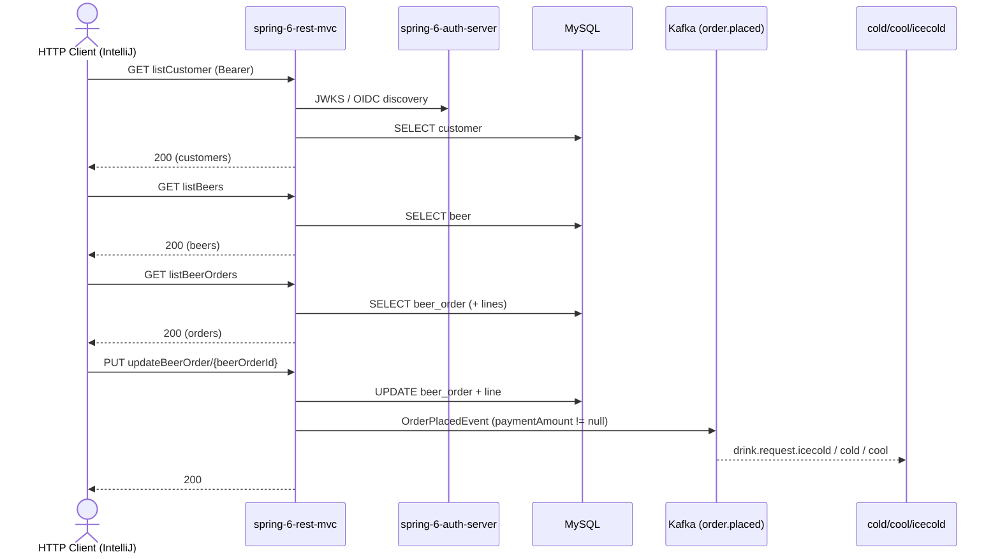

# beerOrder Flow: listBeerOrders → updateBeerOrder

Datei: `restRequest/beerOrder-flow-list-update/beerOrder-flow-list-update.http`

## Ziel

Eine bestehende Bestellung **mit Line** aus der Liste auswählen und aktualisieren.

## Ablauf (Services)

## Requests (in dieser Reihenfolge)

1. `listCustomer` – speichert `customerId` (erster Kunde aus der Liste).
   - alternativ: `createCustomer` – speichert `customerId` (neu angelegter Kunde).
2. `listBeers` – speichert `beerId` (erstes Bier aus der Liste).
3. `listBeerOrders` – wählt die **erste Order, die eine Line hat**, und speichert `beerOrderId` **und** `beerOrderLineId`.
4. `updateBeerOrder` – aktualisiert diese bestehende Order/Line.

## Benötigte Globals

|       Global        |            gesetzt von            |            genutzt von            |
|---------------------|-----------------------------------|-----------------------------------|
| `customerId`        | `listCustomer` / `createCustomer` | `updateBeerOrder`                 |
| `beerId`            | `listBeers`                       | `updateBeerOrder`                 |
| `beerOrderId`       | `listBeerOrders`                  | `updateBeerOrder`                 |
| `beerOrderLineId`   | `listBeerOrders`                  | `updateBeerOrder`                 |
| `traceId`, `spanId` | `../scripts/traceparent.js`       | alle Requests (Trace-Korrelation) |

## Asserts

- `updateBeerOrder` → `200`, `id` entspricht der `{{beerOrderId}}`.

## Hinweise

- Basis-URL ist `{{application-port}}` (Profil `local` = 8081, `k8s` = 30081).
- `listBeerOrders` speichert nur Orders **mit** Line. Gibt es keine, wird `no beer order with a line found` geloggt und
  `beerOrderId`/`beerOrderLineId` bleiben ungesetzt.
- `updateBeerOrder` mit gesetztem `paymentAmount` publiziert ein `OrderPlacedEvent` → Kafka-Topic `order.placed`
  (danach `drink.request.*` durch den `DrinkSplitterRouter`).
- Die Line im Update muss die gespeicherte `beerOrderLineId` mitschicken, sonst 404 (die App sucht die Line per `id`).

